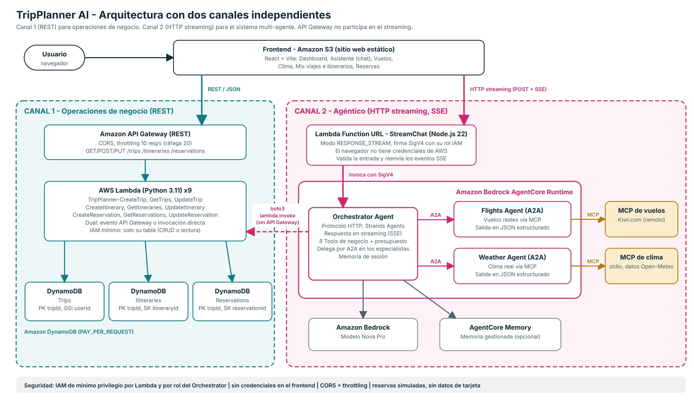

# TripPlanner AI

Planificador de viajes con un **sistema multi-agente** sobre **Amazon Bedrock AgentCore**.
Trabajo final de *Programación Agéntica*.

Le dices al asistente a dónde quieres ir, con quién y con qué presupuesto. Mientras trabaja ves una **línea de tiempo en vivo**: consulta el clima y busca vuelos en paralelo con dos agentes especialistas, calcula si el presupuesto alcanza, arma el itinerario día por día con lugares reales y guarda todo en tu cuenta. Después puedes cambiar el viaje con una frase («quiero que sean 3 días»), reservar un vuelo (simulado) o gestionar todo desde pantallas normales.



---

## Contenido

1. [Qué incluye](#1-qué-incluye)
2. [Arquitectura](#2-arquitectura)
3. [Estructura del repositorio](#3-estructura-del-repositorio)
4. [Requisitos](#4-requisitos)
5. [Probarlo en 2 minutos, sin AWS](#5-probarlo-en-2-minutos-sin-aws)
6. [Desplegarlo en AWS](#6-desplegarlo-en-aws)
7. [Cómo usarlo (con ejemplos)](#7-cómo-usarlo-con-ejemplos)
8. [Cómo manipularlo](#8-cómo-manipularlo)
9. [Pruebas automáticas](#9-pruebas-automáticas)
10. [Seguridad y límites declarados](#10-seguridad-y-límites-declarados)
11. [Problemas frecuentes](#11-problemas-frecuentes)
12. [Eliminar todo](#12-eliminar-todo)
13. [Documentación y autores](#13-documentación-y-autores)

---

## 1. Qué incluye

| Requisito del trabajo | Dónde está |
|---|---|
| 3 agentes: Orchestrator (HTTP con streaming), Flights Agent (A2A + MCP), Weather Agent (A2A + MCP) | `app/OrchestratorAgent`, `app/FlightsAgent`, `app/WeatherAgent` |
| Frontend con 6 módulos | `frontend/src/pages`: Dashboard, Asistente, Vuelos, Clima, Mis viajes, Reservas |
| Interfaz guiada por el agente (Agent-Driven UI) | El agente devuelve eventos JSON y el frontend dibuja tarjetas, la línea de tiempo y los botones de acción |
| Canal 1 (negocio): Frontend → API Gateway → Lambda → DynamoDB | `backend/template.yaml`, `backend/lambdas/*` |
| Canal 2 (agéntico): Frontend → streaming → AgentCore → Orchestrator → agentes y Tools → Lambdas | `backend/lambdas/stream_chat`, `app/OrchestratorAgent` |
| Tools de negocio: CreateTrip, GetTrips, UpdateTrip, CreateItinerary, UpdateItinerary, CreateReservation, GetReservations, UpdateReservation (+ DeleteReservation) | `app/OrchestratorAgent/main.py`, `backend/lambdas/*` |
| Seguridad: mínimo privilegio, sin credenciales en el frontend, CORS, throttling, sin datos de tarjeta | [Sección 10](#10-seguridad-y-límites-declarados) |
| Recuperación de datos al cerrar y volver a abrir | Los viajes viven en DynamoDB, por usuario; la conversación se restaura desde la memoria de AgentCore |

## 2. Arquitectura

Hay **dos canales independientes**:

| Canal | Ruta | Para qué |
|---|---|---|
| 1. Negocio (REST) | Frontend → API Gateway → Lambda → DynamoDB | Dashboard, viajes, itinerarios, reservas |
| 2. Agéntico (streaming) | Frontend → Lambda Function URL (streaming) → AgentCore Orchestrator → Flights / Weather (A2A + MCP) y Tools → Lambdas | Asistente, vuelos, clima |

API Gateway **no** participa en el streaming.

| Agente | Protocolo | Qué hace |
|---|---|---|
| **Orchestrator** | HTTP + streaming (SSE) | Flujo *plan-and-execute*: el código conduce los pasos y el modelo redacta, reparte lugares y resume. Calcula el presupuesto y usa las Tools de negocio |
| **Flights Agent** | A2A | Busca vuelos reales con el servidor MCP de Kiwi.com |
| **Weather Agent** | A2A | Consulta el clima con un servidor MCP propio sobre Open-Meteo |

**¿Por qué el código conduce el flujo y no un agente libre?** Con un modelo de lenguaje, los pasos críticos (pedir los datos que faltan, calcular el presupuesto, guardar, reservar, eliminar) deben ser predecibles. Por eso son deterministas y el modelo solo hace lo que requiere lenguaje. La justificación completa está en la sección 1.4.1 de la [documentación técnica](docs/DOCUMENTACION_TECNICA.md).

## 3. Estructura del repositorio

```
.
├── README.md                  Este archivo
├── agentcore/                 Proyecto AgentCore (CDK): aws-targets.json y agentcore.json
├── app/
│   ├── OrchestratorAgent/     Agente principal. planner.py = flujo plan-and-execute
│   ├── FlightsAgent/          Especialista de vuelos (A2A + MCP de Kiwi.com)
│   └── WeatherAgent/          Especialista de clima (A2A + MCP propio)
├── backend/
│   ├── template.yaml          Plantilla SAM: DynamoDB, API Gateway, Lambdas y bucket del sitio
│   ├── lambdas/               10 Lambdas de negocio (Python) + stream_chat (Node, proxy del streaming)
│   └── tests/                 Pruebas de las Lambdas
├── frontend/                  React + Vite (6 módulos)
│   ├── src/                   Código de la aplicación
│   ├── dev/mock-server.mjs    Servidor de prueba para usar el frontend sin AWS
│   └── deploy-frontend.ps1    Compila y sube el sitio a S3
├── tests/                     Pruebas del Orchestrator, del planificador y de los flujos
├── docs/                      Documentación técnica, diagrama y guion de la demostración
├── deploy-all.ps1             Despliegue completo en un solo comando, con verificaciones
├── cambiar-cuenta.ps1         Prepara el proyecto para la cuenta de AWS que tengas activa
├── setup-iam.ps1              Permisos de mínimo privilegio para los agentes
├── configure_agentcore.py     Completa agentcore.json con los ids reales
└── set_model.py               Elige el modelo de lenguaje (Bedrock o API externa)
```

## 4. Requisitos

| Herramienta | Para qué | Cómo comprobarla |
|---|---|---|
| Node.js 20 o superior y npm | Frontend, Lambda de streaming y AgentCore CLI | `node -v` |
| Python 3.11 o superior | Scripts y pruebas | `python --version` |
| AWS CLI v2 | Despliegue | `aws --version` |
| AWS SAM CLI | Backend | `sam --version` |
| AgentCore CLI | Desplegar los tres agentes | `agentcore --version` (se instala con `npm install -g @aws/agentcore`) |
| Una cuenta de AWS con **Bedrock habilitado** para Nova Pro en `us-east-1` | Los agentes | Ver [sección 11](#11-problemas-frecuentes) si es una cuenta nueva |

Los comandos de este documento son para **PowerShell en Windows** y se ejecutan en la **terminal**, desde la raíz del proyecto.

## 5. Probarlo en 2 minutos, sin AWS

Sirve para ver la interfaz completa funcionando. Un servidor de prueba simula los dos canales (no usa agentes reales, así que los datos son de ejemplo).

```powershell
cd frontend
npm install
npm run mock
```

En **otra** terminal, también dentro de `frontend`:

```powershell
npm run dev
```

Abre la dirección que imprime `npm run dev` (normalmente `http://localhost:5173`). Para que el frontend apunte al servidor de prueba, edita **temporalmente** `frontend/public/config.js`:

```js
window.TRIPPLANNER_CONFIG = {
  API_URL: "http://localhost:8787",
  STREAM_URL: "http://localhost:8787",
};
```

(Antes de subir cambios al repositorio, deja `config.js` con las dos URLs vacías: el despliegue lo reescribe solo.)

## 6. Desplegarlo en AWS

Tarda unos 6 minutos la primera vez. Todo se hace en la terminal, desde la raíz del proyecto.

**Paso 1. Credenciales de AWS** (una sola vez; usa un perfil con permisos de administración de tu cuenta):

```powershell
aws configure --profile tripplanner
$env:AWS_PROFILE = "tripplanner"
aws sts get-caller-identity --query Account --output text
```

El último comando debe imprimir el número de **tu** cuenta. Si imprime otro, detente y revisa el perfil.

**Paso 2. Apuntar el proyecto a tu cuenta** (cambia `agentcore/aws-targets.json` a la cuenta activa, vuelve a Bedrock Nova Pro como modelo y comprueba que Bedrock responde):

```powershell
powershell -ExecutionPolicy Bypass -File .\cambiar-cuenta.ps1
```

**Paso 3. Desplegar todo:**

```powershell
powershell -ExecutionPolicy Bypass -File .\deploy-all.ps1
```

El script ejecuta siete pasos y verifica cada uno:

| Paso | Qué hace |
|---|---|
| 1 | Revisión previa: herramientas, sintaxis de los agentes, cuenta, acceso al modelo |
| 2 | Despliega Flights, Weather y la memoria |
| 3 | Despliega el backend: DynamoDB, Lambdas, API Gateway |
| 4 | Despliega el Orchestrator y aplica los permisos IAM |
| 5 | Crea el proxy de streaming con el ARN del Orchestrator |
| 6 | Pruebas rápidas de los dos canales |
| 7 | Compila y sube el frontend a S3 |

Al final imprime la **URL del sitio**. Si un paso falla, el script se detiene, explica el motivo y deja el registro en `deploy.log`. Se retoma sin repetir lo anterior:

```powershell
powershell -ExecutionPolicy Bypass -File .\deploy-all.ps1 -From 4
```

Opciones útiles:

```powershell
# Otro modelo de Bedrock
powershell -ExecutionPolicy Bypass -File .\deploy-all.ps1 -ModelId us.amazon.nova-lite-v1:0

# Limitar el CORS del streaming al sitio web (recomendado para producción)
powershell -ExecutionPolicy Bypass -File .\deploy-all.ps1 -From 7 -RestrictCors
```

Si tu cuenta de AWS es nueva y Bedrock devuelve `Too many tokens per day`, lee [`docs/MODELO_EXTERNO.md`](docs/MODELO_EXTERNO.md): explica cómo usar una API externa compatible con OpenAI guardando la clave en AWS Secrets Manager (nunca en el repositorio).

**Comprobar que quedó bien:**

| Comprobación | Resultado esperado |
|---|---|
| Abrir la URL del sitio | Pantalla de bienvenida de TripPlanner |
| Escribir `hola` en el Asistente | Respuesta breve (calienta el agente; la primera llamada tarda por el arranque en frío) |
| Pegar el prompt de la sección 7 | Línea de tiempo de 7 pasos que se completa en vivo |
| Consola de DynamoDB | Registros en `TripPlanner-Trips`, `TripPlanner-Itineraries` y `TripPlanner-Reservations` |

## 7. Cómo usarlo (con ejemplos)

Abre el sitio, escribe tu nombre para entrar (cada nombre tiene sus propios viajes) y ve a **Asistente**.

### 7.1 Planificar un viaje

Prompt de la demostración:

> Quiero organizar unas vacaciones de cuatro días en Cartagena. Salgo desde Bogotá, viajo con dos personas más y tengo un presupuesto de 5 millones de pesos. Quiero conocer el clima, encontrar vuelos y organizar algunas actividades turísticas.

Lo que verás, en este orden:

1. **Entender tu solicitud**: origen, destino, días, viajeros y presupuesto.
2. **Clima** y **Vuelos** al mismo tiempo, cada uno con su agente.
3. **Presupuesto**: vuelos de ida y vuelta, hospedaje y comidas estimados, y si alcanza.
4. **Itinerario** día por día con lugares reales del destino, adaptado al clima.
5. **Guardar el viaje** y el itinerario en tu cuenta.
6. Un resumen y botones: **Reservar el vuelo más barato** y **Ver mis viajes**.

El botón **Detalles técnicos** de la línea de tiempo muestra qué agente y qué herramienta hizo cada paso (A2A, MCP, Lambda…). Está apagado por defecto: una persona usuaria normal no necesita esa jerga.

### 7.2 Si faltan datos, pregunta

| Escribes | El asistente |
|---|---|
| `quiero hacer un viaje a cartagena` | Pide lo que falta: ciudad de salida, personas y presupuesto |
| `salgo de barranquilla, somos 5 y tenemos 5 millones` | Arma el plan completo |
| `quiero viajar a brasil desde barranquilla, somos 2 con 10 millones` | Pide una ciudad concreta (por ejemplo, Río de Janeiro) |

### 7.3 Cambiar un viaje ya armado

Con un viaje activo, escribe en lenguaje natural:

| Escribes | Qué cambia |
|---|---|
| `quiero que sean 3 días nada más` | Duración, presupuesto recalculado con el precio real del vuelo e itinerario de 3 días |
| `cambia el presupuesto a 4 millones` | Presupuesto |
| `somos 3 personas` | Viajeros y costos |
| `alarga el viaje 2 días` | Duración e itinerario |
| `cambia las fechas del 10 al 13 de diciembre` | Fechas; vuelve a consultar clima y vuelos |
| `cambia el destino a Medellín` | Destino, clima, vuelos e itinerario |

La línea de tiempo marca «Sin cambios» en los pasos que no hace falta repetir (por ejemplo, reutiliza el vuelo más barato ya encontrado).

### 7.4 Reservar y eliminar reservas (simuladas)

| Escribes o pulsas | Resultado |
|---|---|
| Botón **Reservar el vuelo más barato** (o `Reserva el vuelo de las 09:00`) | Crea una reserva `SIMULADA` visible en **Reservas** |
| Reservar el mismo vuelo otra vez | No crea un duplicado: avisa que ya está reservado |
| `elimina la reserva` | Si hay varias, pregunta cuál; responde `la 1` |
| `elimina la reserva que hice` | Borra solo la última |

Las reservas **no usan datos de tarjeta ni cobran nada**.

### 7.5 Las pantallas

| Módulo | Para qué |
|---|---|
| **Dashboard** | Resumen de tus viajes y el próximo viaje |
| **Asistente** | Conversación con streaming y línea de tiempo interactiva |
| **Vuelos** | Busca vuelos por ruta y fecha (los consulta el Flights Agent) |
| **Clima** | Pronóstico de cualquier ciudad (lo consulta el Weather Agent) |
| **Mis viajes** | Tus viajes, con itinerario editable (se guarda por la API REST) |
| **Reservas** | Cambiar el estado de una reserva o eliminarla |

### 7.6 Recuperar los datos al volver

Cierra el navegador, abre el sitio y entra con **el mismo nombre**: el Dashboard, **Mis viajes** y **Reservas** muestran todo lo guardado, porque los datos viven en DynamoDB.

## 8. Cómo manipularlo

### 8.1 Llamar directamente al Canal 1 (API REST)

Obtén la URL de la API del stack:

```powershell
$API = aws cloudformation describe-stacks --stack-name tripplanner-backend --region us-east-1 --query "Stacks[0].Outputs[?OutputKey=='ApiUrl'].OutputValue | [0]" --output text
$API = $API.Trim().TrimEnd("/")
$API
```

Listar los viajes de un usuario:

```powershell
curl.exe -s "$API/trips?userId=miller"
```

Crear un viaje (en PowerShell, el JSON va en un archivo para evitar problemas de comillas):

```powershell
@'
{"userId":"miller","origin":"Bogotá","destination":"Cartagena","startDate":"2026-12-03","endDate":"2026-12-07","travelers":3,"budget":5000000}
'@ | Set-Content -Encoding utf8 trip.json
curl.exe -s -X POST "$API/trips" -H "Content-Type: application/json" --data-binary "@trip.json"
Remove-Item trip.json
```

Todas las rutas (viajes, itinerarios, reservas) están en la sección 3.1 de la [documentación técnica](docs/DOCUMENTACION_TECNICA.md).

### 8.2 Cambiar el modelo de lenguaje

```powershell
python set_model.py --show                                              # ver el modelo actual
python set_model.py --provider bedrock --model-id amazon.nova-pro-v1:0  # volver a Bedrock
```

Después, `deploy-all.ps1 -From 4` aplica el cambio. Para usar una API externa, ver [`docs/MODELO_EXTERNO.md`](docs/MODELO_EXTERNO.md).

### 8.3 Agregar un destino al catálogo de lugares

`app/OrchestratorAgent/planner.py` tiene el diccionario `PLACES` con lugares reales por destino (24 destinos). Los destinos que no estén ahí reciben un itinerario general con actividades genéricas. Para agregar uno, copia una entrada, cambia la ciudad y los lugares, y vuelve a desplegar el Orchestrator con `deploy-all.ps1 -From 4`.

### 8.4 Ver qué hacen los agentes

Los registros de cada agente están en CloudWatch, grupo `/aws/bedrock-agentcore/runtimes/<id>-DEFAULT`. El Orchestrator escribe líneas con prefijos como `[plan]`, `[update]` y `[agent]`.

## 9. Pruebas automáticas

No requieren cuenta de AWS.

```powershell
# Lambdas de negocio (DynamoDB simulado)
cd backend
pip install "moto[dynamodb]" boto3 pytest
python -m pytest tests -q
cd ..

# Proxy de streaming y firma SigV4
node backend/test_stream.mjs
node backend/test_sigv4.mjs

# Orchestrator, planificador y flujos (con las dependencias de los agentes instaladas)
python tests/test_planner.py
python tests/test_flows.py
python tests/test_orchestrator.py
python tests/test_trip_guard.py
python tests/test_llm_provider.py
python tests/test_a2a_urllib.py
```

La tabla de qué verifica cada una está en la sección 8 de la [documentación técnica](docs/DOCUMENTACION_TECNICA.md).

## 10. Seguridad y límites declarados

**Lo que sí tiene**

- **Mínimo privilegio:** cada Lambda y cada agente tiene su propio rol IAM con permisos solo sobre lo que usa. El rol del Orchestrator solo puede invocar a los dos especialistas, las Lambdas de negocio y la memoria.
- **Sin credenciales en el frontend:** `config.js` solo contiene dos URLs públicas.
- **Sin datos de tarjeta:** las reservas son simuladas.
- **API Gateway** con CORS y *throttling* (10 solicitudes por segundo, ráfaga de 20).
- **Claves de modelos externos** solo en AWS Secrets Manager, nunca en el código ni en el repositorio.
- **Validación de entradas** en las Lambdas y saneamiento de las acciones que llegan desde el navegador.

**Límites del alcance (declarados, no ocultos)**

- **Sin autenticación real:** el «inicio de sesión» identifica a la persona por su nombre; no hay contraseña. En producción se usaría Amazon Cognito. El nombre determina qué viajes se ven.
- **Function URL del streaming público**, con CORS configurable (`-RestrictCors`).
- **Reservas simuladas**, sin pasarela de pago.
- **Servicios externos:** Open-Meteo puede limitar las consultas por IP y Kiwi.com puede tardar; el sistema muestra un paso en rojo con botón **Reintentar** y entrega el resto del plan.

## 11. Problemas frecuentes

| Síntoma | Qué hacer |
|---|---|
| `Too many tokens per day` en la revisión previa | Cuenta de AWS nueva con cuotas de Bedrock en 0. Usa otra cuenta, otro modelo (`-ModelId`) o una API externa (`docs/MODELO_EXTERNO.md`) |
| El script se detiene en un paso | Lee el mensaje: dice el motivo. Corrige y retoma con `-From <paso>` |
| «Block Public Access» al subir el sitio | La cuenta bloquea los buckets públicos. El script imprime el comando exacto para permitirlo en ese bucket |
| El chat dice «No se pudo conectar con el asistente» | Haz **Ctrl+F5**; si sigue, `deploy-all.ps1 -From 5` |
| Un paso queda en rojo (por ejemplo, el clima) | Servicio externo que no respondió. Pulsa **Reintentar** en ese paso |
| La primera respuesta tarda | Arranque en frío del agente. Escribe `hola` antes de empezar |

La lista completa está en la sección 7.10 de la [documentación técnica](docs/DOCUMENTACION_TECNICA.md).

## 12. Eliminar todo

Para no dejar recursos facturando, primero vacía el bucket del sitio y luego borra los dos stacks:

```powershell
$bucket = aws cloudformation describe-stacks --stack-name tripplanner-backend --region us-east-1 --query "Stacks[0].Outputs[?OutputKey=='FrontendBucketName'].OutputValue | [0]" --output text
aws s3 rm "s3://$bucket" --recursive
aws cloudformation delete-stack --stack-name tripplanner-backend --region us-east-1
aws cloudformation delete-stack --stack-name AgentCore-tripplannera2a-default --region us-east-1
```

## 13. Documentación y autores

- [Documentación técnica](docs/DOCUMENTACION_TECNICA.md): arquitectura, modelo de datos, APIs, Lambdas, Tools, integración de agentes, instrucciones de ejecución, pruebas y cobertura de la rúbrica.
- [Guion de la demostración](docs/GUION_DEMO.md)
- [Modelo de lenguaje: Bedrock o API externa](docs/MODELO_EXTERNO.md)

**Autores**

- Miller Andrés Pacheco Rangel · GitHub [@IngMiller07](https://github.com/IngMiller07)
- Juan Armella
- Cristian Marquez

Corporación Universitaria Latinoamericana (CUL) · Programación Agéntica · Trabajo final
