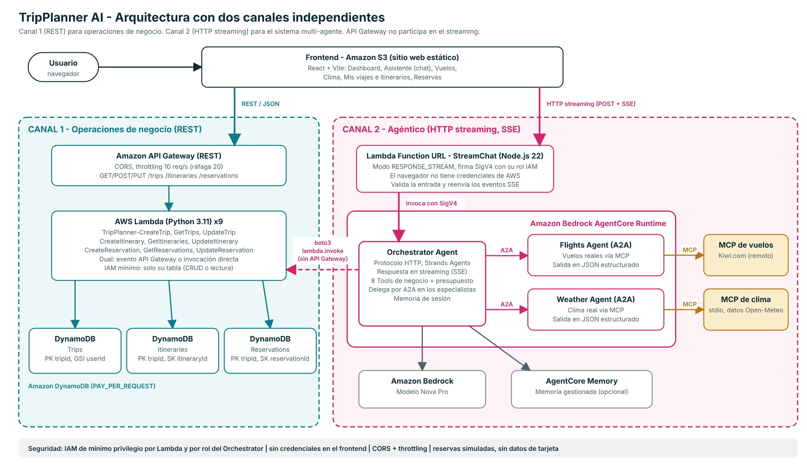

# TripPlanner AI — Documentación técnica

Trabajo final — Programación Agéntica (Amazon Bedrock AgentCore)

TripPlanner AI es una aplicación web para planear viajes con un sistema multi-agente. El usuario conversa con un asistente que consulta el clima, busca vuelos reales, calcula el presupuesto, arma un itinerario y guarda todo en DynamoDB. Además puede gestionar sus viajes, itinerarios y reservas desde pantallas normales, sin hablar con el agente.

Contenido

1. [Arquitectura](#1-arquitectura)
2. [Modelo de datos](#2-modelo-de-datos)
3. [APIs](#3-apis)
4. [Lambdas](#4-lambdas)
5. [Tools](#5-tools)
6. [Integración de agentes](#6-integración-de-agentes)
7. [Instrucciones de ejecución](#7-instrucciones-de-ejecución)
8. [Pruebas](#8-pruebas)
9. [Cobertura de la rúbrica](#9-cobertura-de-la-rúbrica)

---

## 1. Arquitectura



La arquitectura tiene **dos canales independientes**. Que sean independientes es una decisión de diseño: cada uno tiene un propósito distinto, un protocolo distinto y puede fallar o escalar sin afectar al otro.

### 1.1 Canal 1 — Operaciones de negocio (REST)

```
Frontend (S3) → API Gateway → Lambda (Python) → DynamoDB
```

Lo usan las pantallas que no necesitan un agente: el Dashboard, Mis viajes (con edición del itinerario) y Reservas (con cambio de estado). Es una API REST clásica, síncrona, con respuestas JSON.

### 1.2 Canal 2 — Agéntico (HTTP streaming)

```
Frontend (S3) → Lambda Function URL (StreamChat) → AgentCore Runtime (Orchestrator)
                                                     ├─ A2A → Flights Agent → MCP Kiwi.com
                                                     ├─ A2A → Weather Agent → MCP clima (Open-Meteo)
                                                     └─ 9 Tools de negocio → boto3 lambda.invoke → Lambdas → DynamoDB
```

Lo usan el Asistente, la búsqueda de Vuelos y el Clima. La respuesta llega por Server-Sent Events (SSE): una **línea de tiempo del agente** que avanza paso a paso, los resultados estructurados de cada herramienta y el texto final, token a token.

**API Gateway no participa en este canal.** Es un requisito de diseño del trabajo y además tiene sentido técnico: una respuesta de agente puede tardar decenas de segundos, y el límite de integración de API Gateway es de 29 segundos por defecto. Por eso el navegador llama a una **Lambda Function URL** en modo `RESPONSE_STREAM`, que admite streaming de forma nativa y evita un salto intermedio.

### 1.3 Componentes

| Componente | Servicio AWS | Función |
|---|---|---|
| Frontend | S3 (sitio web estático) | React + Vite compilado. Configuración pública en `config.js` (solo dos URLs). |
| API de negocio | API Gateway REST | 10 rutas, CORS y throttling (10 req/s, ráfaga 20). |
| Lambdas de negocio | Lambda (Python 3.11) ×10 | CRUD de viajes, itinerarios y reservas (incluye eliminar reservas). |
| Base de datos | DynamoDB ×3 tablas | `PAY_PER_REQUEST`, sin servidores que administrar. |
| Proxy de streaming | Lambda (Node.js 22) + Function URL | Recibe el chat, firma con SigV4 y reenvía el SSE de AgentCore. |
| Orchestrator | AgentCore Runtime (protocolo HTTP) | Agente principal. Planifica con un flujo *plan-and-execute*, delega en los especialistas y usa las tools. |
| Flights Agent | AgentCore Runtime (protocolo A2A) | Busca vuelos reales con el MCP de Kiwi.com. |
| Weather Agent | AgentCore Runtime (protocolo A2A) | Consulta el clima con un servidor MCP propio (Open-Meteo). |
| Modelo | Amazon Bedrock (Nova Pro) | `amazon.nova-pro-v1:0` para los tres agentes. |
| Memoria | AgentCore Memory | Memoria de conversación gestionada (opcional). |

### 1.4 Flujo del escenario principal

Prompt de la demostración: *«Quiero organizar unas vacaciones de cuatro días en Cartagena. Salgo desde Bogotá, viajo con dos personas más y tengo un presupuesto de 5 millones de pesos. Quiero conocer el clima, encontrar vuelos y organizar algunas actividades turísticas.»*

1. El navegador hace `POST` al Function URL con `{prompt, userId, sessionId, history, context, action?}`.
2. `StreamChat` valida la entrada, firma la llamada con SigV4 usando su rol IAM e invoca al Orchestrator.
3. El Orchestrator **entiende la petición con reglas** (origen Bogotá, destino Cartagena, 4 días, 3 viajeros, 5.000.000 COP) y solo usa el modelo si falta algún dato. Nunca inventa el origen, los viajeros ni el presupuesto: si falta alguno, pregunta. Si no hay fechas, asume una salida diez días después de hoy y lo avisa.
4. Emite el evento `plan` con los 7 pasos de la **línea de tiempo** y los ejecuta: el clima (Weather Agent, A2A + MCP Open-Meteo) y los vuelos (Flight Agent, A2A + MCP Kiwi) **en paralelo**; luego el presupuesto, el itinerario con lugares reales del destino, `create_trip` y `create_itinerary` (Lambdas → DynamoDB). Cada paso emite `step` con su estado, su tiempo y su detalle.
5. Un resumen final de pocas líneas lo escribe el modelo con los resultados reales y propone acciones (botones): «Reservar el vuelo más barato», «Ver mis viajes».
6. Si el usuario pulsa «Reservar» (o escribe «reserva el vuelo más barato»), el Orchestrator ejecuta una segunda línea de tiempo de dos pasos y llama `create_reservation`. La reserva es simulada, pero queda guardada en DynamoDB. Reservar, consultar, cambiar el estado y **eliminar** una reserva se puede hacer por el chat o por los botones de la pantalla Reservas; ambos caminos terminan en las mismas Lambdas. Dos reglas de coherencia las aplica el código, no el modelo: (a) **no se duplica** una reserva: antes de crear, el Orchestrator consulta las reservas del viaje y, si ese mismo vuelo ya está reservado, no crea otra y lo explica; (b) **eliminar** nunca borra más de lo pedido (ver 6.2.1).

### 1.4.1 Por qué un flujo *plan-and-execute* y no un agente libre

Con un modelo como Nova Pro, dejar que el propio modelo decida cada llamada produjo fallos repetidos en las pruebas: ignoraba partes de un prompt largo, inventaba el origen o el presupuesto, mezclaba lugares de otras ciudades o se detenía a mitad del flujo. En lugar de seguir añadiendo reglas al prompt, el Orchestrator separa responsabilidades:

| Quién | Qué decide |
|---|---|
| **Código determinista** (`planner.py`) | El orden de los pasos, qué llamar en paralelo, cuántos reintentos, validar los datos, calcular el presupuesto y guardar; también **reservar** (sin duplicar) y **eliminar reservas** (decide cuál se borra). Es lo que garantiza que el flujo se completa siempre igual. |
| **El modelo (Nova Pro)** | Lo que sí requiere lenguaje: leer una petición ambigua (solo si las reglas no bastan), repartir lugares reales por día según el clima y redactar el resumen final. |
| **El agente libre (Strands)** | Todo lo demás: modificar un viaje, consultar reservas, buscar hoteles, pedir recomendaciones. Conserva las 12 herramientas (incluida `delete_reservation`). |

El mismo código sigue usando agentes: el Orchestrator delega en dos agentes especialistas por A2A, cada uno con su MCP, y las Tools se invocan igual que antes. Lo que cambia es que el flujo principal ya no depende de la suerte del modelo.

### 1.5 Seguridad

| Medida | Dónde se aplica |
|---|---|
| **Mínimo privilegio en las Lambdas** | Cada Lambda de negocio solo accede a su tabla. Las de lectura usan `DynamoDBReadPolicy` y las de escritura `DynamoDBCrudPolicy`, ambas limitadas a una tabla. |
| **Mínimo privilegio en el Orchestrator** | Su rol puede invocar únicamente a los dos especialistas (`runtime/tripplannera2a_FlightsAgent-*` y `…WeatherAgent-*`), usar su memoria y ejecutar las 9 Lambdas de negocio que usa como tools, por ARN explícito. Lo aplica `setup-iam.ps1`. |
| **Mínimo privilegio en StreamChat** | Solo `bedrock-agentcore:InvokeAgentRuntime` sobre el ARN del Orchestrator. |
| **Sin credenciales en el frontend** | El navegador no recibe claves de AWS. `config.js` contiene solo dos URLs públicas. La firma SigV4 ocurre dentro de Lambda con credenciales temporales de su rol. |
| **Sin datos de tarjeta** | No existe ningún campo de pago. El prompt del agente le prohíbe pedirlos o aceptarlos. Las reservas son simuladas. |
| **CORS** | API Gateway responde a preflight. El streaming usa el parámetro `AllowedOrigin` del stack. |
| **Throttling** | API Gateway limita a 10 req/s con ráfaga de 20. |
| **Validación de entrada** | Todas las Lambdas validan campos obligatorios, tipos y valores permitidos y devuelven 400. `StreamChat` limita el mensaje a 2000 caracteres, el historial a 20 mensajes y el `userId` a 64 caracteres. |
| **Clave del modelo externo** | Si se usa una API externa en lugar de Bedrock, su clave vive en AWS Secrets Manager (`tripplanner/llm-api-key`). Los roles de los agentes pueden leer solo ese secreto. La clave no está en `agentcore.json`, en el repositorio ni en `deploy.log`. |
| **Sin secretos en el repositorio** | `.gitignore` excluye `.env`, claves y carpetas de build. `git-init.ps1` escanea el repositorio antes de confirmar. |

### 1.6 Decisiones y límites del alcance

Son decisiones conscientes, tomadas para entregar a tiempo, y se declaran aquí para que se lean como tales:

- **Sin autenticación de usuarios.** El `userId` sale del nombre que el usuario escribe al entrar. Sirve para separar los datos de una demostración, no para aislar usuarios de forma segura. En producción iría Amazon Cognito. Para que la entrada sea coherente, la pantalla inicial avisa si la cuenta ya existe (consulta `GET /trips`, «Encontré 3 viajes guardados de «Miller»») o es nueva, y recuerda en el navegador los nombres usados para volver a entrar con un clic (`localStorage`, solo nombres; los datos viven en DynamoDB). Quien escribe el mismo nombre desde otro navegador ve los mismos viajes, itinerarios y reservas.
- **El Function URL es público** (`AuthType NONE`). Esto es lo que permite que el navegador lo llame sin credenciales de AWS. Cualquiera que conozca la URL puede invocar al agente, y eso tiene costo. Para producción se pondría CloudFront con WAF, o Cognito delante.
- **CORS abierto por defecto** (`*`). Para restringirlo basta pasar `AllowedOrigin` con la URL del sitio S3 al desplegar (ver 7.6). En API Gateway y en las respuestas de las Lambdas queda en `*`.
- **El sitio S3 se sirve por HTTP.** En producción iría detrás de CloudFront con HTTPS.
- **Las reservas son simuladas**, como pide el enunciado. No hay integración con aerolíneas ni hoteles.
- **Estimados de presupuesto.** `calculate_budget` usa tarifas de referencia (hospedaje 150.000 COP por persona y noche; alimentación y actividades 120.000 COP por persona y día; 4.000 COP por USD). Son aproximaciones y el agente las presenta como estimado.

---

## 2. Modelo de datos

Tres tablas DynamoDB en modo `PAY_PER_REQUEST`. La relación es por `tripId`: un viaje tiene muchos itinerarios y muchas reservas.

```
TripPlanner-Trips (1) ──< (N) TripPlanner-Itineraries
        └──────────────< (N) TripPlanner-Reservations
```

### 2.1 `TripPlanner-Trips`

| Elemento | Detalle |
|---|---|
| Clave de partición | `tripId` (S), un UUID |
| Índice secundario global | `userId-index`, con clave de partición `userId` y proyección `ALL` |
| Patrón de acceso | Obtener todos los viajes de un usuario (consulta al índice) y actualizar un viaje por id |

| Atributo | Tipo | Descripción |
|---|---|---|
| `tripId` | S | Identificador del viaje (UUID generado por la Lambda) |
| `userId` | S | Dueño del viaje |
| `origin` | S | Ciudad de origen |
| `destination` | S | Ciudad de destino |
| `startDate`, `endDate` | S | Fechas del viaje |
| `travelers` | N | Número de viajeros (entero ≥ 1) |
| `budget` | N | Presupuesto total en COP (≥ 0, opcional) |
| `status` | S | `PLANEANDO`, `RESERVADO`, `COMPLETADO` o `CANCELADO` |
| `createdAt`, `updatedAt` | S | Marcas de tiempo ISO 8601 en UTC |

Ejemplo:

```json
{
  "tripId": "8d1c0a52-6c1e-4f7a-9b1d-2e7a5c0d9e11",
  "userId": "miller",
  "origin": "Bogotá",
  "destination": "Cartagena",
  "startDate": "2026-12-03",
  "endDate": "2026-12-07",
  "travelers": 3,
  "budget": 5000000,
  "status": "PLANEANDO",
  "createdAt": "2026-11-23T18:50:12.114+00:00",
  "updatedAt": "2026-11-23T18:50:12.114+00:00"
}
```

### 2.2 `TripPlanner-Itineraries`

| Elemento | Detalle |
|---|---|
| Clave de partición | `tripId` (S) |
| Clave de ordenación | `itineraryId` (S), un UUID |
| Patrón de acceso | Listar los itinerarios de un viaje (consulta por `tripId`) y reemplazar los días de uno |

| Atributo | Tipo | Descripción |
|---|---|---|
| `tripId`, `itineraryId` | S | Clave compuesta |
| `days` | L | Lista de días: `{day, title?, activities[]}` |
| `createdAt`, `updatedAt` | S | Marcas de tiempo ISO 8601 |

```json
{
  "tripId": "8d1c0a52-…",
  "itineraryId": "5b0f3c7e-…",
  "days": [
    {"day": 1, "title": "Llegada", "activities": ["Vuelo BOG-CTG", "Check-in en el hotel", "Cena en Getsemaní"]},
    {"day": 2, "title": "Ciudad amurallada", "activities": ["Tour a pie por el centro histórico", "Atardecer en el Café del Mar"]}
  ],
  "createdAt": "2026-11-23T18:50:40.000+00:00",
  "updatedAt": "2026-11-23T18:50:40.000+00:00"
}
```

### 2.3 `TripPlanner-Reservations`

| Elemento | Detalle |
|---|---|
| Clave de partición | `tripId` (S) |
| Clave de ordenación | `reservationId` (S), un UUID |
| Patrón de acceso | Listar las reservas de un viaje y cambiar el estado de una |

| Atributo | Tipo | Descripción |
|---|---|---|
| `tripId`, `reservationId` | S | Clave compuesta |
| `type` | S | `VUELO`, `HOTEL` o `ACTIVIDAD` |
| `details` | M | Datos libres de lo reservado (aerolínea, vuelo, horario, precio…) |
| `status` | S | `SIMULADA` (valor inicial), `PENDIENTE` o `CONFIRMADA` |
| `createdAt`, `updatedAt` | S | Marcas de tiempo ISO 8601 |

```json
{
  "tripId": "8d1c0a52-…",
  "reservationId": "c2f9e7a0-…",
  "type": "VUELO",
  "details": {"airline": "Avianca", "flight": "AV9455", "depart": "06:10", "arrive": "07:45", "price_usd": 121.5},
  "status": "SIMULADA",
  "createdAt": "2026-11-23T18:52:03.000+00:00",
  "updatedAt": "2026-11-23T18:52:03.000+00:00"
}
```

### 2.4 Notas de diseño

- **Por qué estas claves.** Todo se consulta por viaje. Con `tripId` como partición y el id propio como ordenación, listar los itinerarios o las reservas de un viaje es una sola consulta, sin escaneos. El índice `userId-index` cubre el único acceso por usuario.
- **Números.** DynamoDB no acepta `float`. Las Lambdas convierten a `Decimal` al escribir y devuelven `int` o `float` al leer.
- **Actualizaciones seguras.** Las tres operaciones de actualización llevan `ConditionExpression: attribute_exists(tripId)`. Si el registro no existe devuelven 404 en lugar de crear uno vacío.
- **Sin relación forzada.** DynamoDB no tiene claves foráneas. Un itinerario o una reserva con un `tripId` inexistente se puede crear. La aplicación siempre los crea con el id de un viaje que acaba de guardar.

---

## 3. APIs

### 3.1 Canal 1 — API REST de negocio

URL base: la salida `ApiUrl` del stack (`https://<id>.execute-api.us-east-1.amazonaws.com/Prod`). Todas las respuestas son JSON y llevan `Access-Control-Allow-Origin`.

| Método y ruta | Lambda | Entrada | Respuesta correcta |
|---|---|---|---|
| `POST /trips` | CreateTrip | Cuerpo: `userId`, `origin`, `destination`, `startDate`, `endDate` (obligatorios); `travelers` (por defecto 1), `budget` | `201` con el viaje creado |
| `GET /trips?userId=` | GetTrips | Consulta: `userId` | `200` `{"trips": [...]}` |
| `PUT /trips/{tripId}` | UpdateTrip | Cuerpo: cualquiera de `origin`, `destination`, `startDate`, `endDate`, `travelers`, `budget`, `status` | `200` con el viaje actualizado |
| `POST /itineraries` | CreateItinerary | Cuerpo: `tripId`, `days` (lista) | `201` con el itinerario |
| `GET /itineraries?tripId=` | GetItineraries | Consulta: `tripId` | `200` `{"itineraries": [...]}` |
| `PUT /itineraries/{tripId}/{itineraryId}` | UpdateItinerary | Cuerpo: `days` (lista completa) | `200` con el itinerario |
| `POST /reservations` | CreateReservation | Cuerpo: `tripId`, `type` (obligatorios); `details` (objeto), `status` | `201` con la reserva |
| `GET /reservations?tripId=` | GetReservations | Consulta: `tripId` | `200` `{"reservations": [...]}` |
| `PUT /reservations/{tripId}/{reservationId}` | UpdateReservation | Cuerpo: `status` | `200` con la reserva |
| `DELETE /reservations/{tripId}/{reservationId}` | DeleteReservation | Parámetros de ruta: `tripId`, `reservationId` | `200` `{"deleted": true, "tripId", "reservationId"}` |

**Errores** (formato `{"error": "mensaje"}`):

| Código | Cuándo |
|---|---|
| `400` | Faltan campos, el cuerpo no es JSON válido, `travelers` no es un entero ≥ 1, `budget` no es numérico o es negativo, `status` o `type` fuera de los valores permitidos, `days` no es una lista, `details` no es un objeto |
| `404` | Se intenta actualizar un viaje, itinerario o reserva que no existe, o eliminar una reserva que no existe |
| `429` | Se supera el límite de throttling (10 req/s, ráfaga 20) |
| `500` | Error inesperado (por ejemplo, un fallo de DynamoDB) |

Ejemplo:

```bash
curl -X POST "$API/trips" -H "Content-Type: application/json" -d '{
  "userId": "miller", "origin": "Bogotá", "destination": "Cartagena",
  "startDate": "2026-12-03", "endDate": "2026-12-07", "travelers": 3, "budget": 5000000
}'
```

### 3.2 Canal 2 — Streaming del agente

**Endpoint:** la salida `StreamUrl` del stack, una Lambda Function URL (`https://<id>.lambda-url.us-east-1.on.aws/`).

**Solicitud:** `POST`, `Content-Type: application/json`.

| Campo | Tipo | Descripción |
|---|---|---|
| `prompt` | string | Mensaje del usuario. Obligatorio, máximo 2000 caracteres |
| `userId` | string | Identifica al usuario. Máximo 64 caracteres (por defecto `demo-user`) |
| `sessionId` | string | Identifica la conversación. AgentCore exige 33 caracteres o más; la Lambda lo completa si hace falta |
| `action` | objeto (opcional) | Acción de un botón, por ejemplo `{"type":"reserve_flight","flight":{…},"tripId":"…"}` o `{"type":"delete_reservation","reservationId":"…"}` (o `"all":true`). El Orchestrator la ejecuta de forma determinista, sin pasar por el modelo; los datos del vuelo se sanean y una reserva solo se elimina si pertenece a los viajes consultados |
| `history` | array | Mensajes previos (se conservan los últimos 20) |
| `context` | objeto | Estado de la pantalla: viaje activo, vuelos ya mostrados, etc. |

**Respuesta:** `200` con `Content-Type: text/event-stream`. Cada evento es una línea `data: {json}` seguida de una línea en blanco.

| `type` | Campos | Significado |
|---|---|---|
| `start` | `sessionId`, `userId` | La conversación empezó |
| `text` | `data` | Fragmento de texto de la respuesta del agente |
| `tool_start` | `name`, `id`, `step?` | El agente empezó a usar una herramienta. `step` la enlaza con un paso de la línea de tiempo |
| `tool_result` | `id`, `name`, `status`, `data`, `step?` | Resultado estructurado (JSON) de esa herramienta |
| `plan` | `id`, `title`, `steps[]` | Arranca una **línea de tiempo**: lista de pasos (`id`, `label`, `agent`, `via`) todavía pendientes |
| `step` | `plan`, `id`, `status`, `detail?`, `ms?`, `attempt?`, `assumptions?`, `retry?` | Un paso cambia de estado: `running`, `done`, `error` u `skipped`. Un paso con error trae el texto de `retry` que el botón «Reintentar» reenvía |
| `plan_done` | `plan`, `ok`, `ms` | La línea de tiempo terminó (`ok` es falso si algún paso falló) |
| `suggestions` | `items[]` | Acciones sugeridas como botones: reservar el vuelo más barato, ver mis viajes, ver mis reservas |
| `ping` | — | Latido cada pocos segundos mientras un paso espera a un especialista, para que la conexión no se cierre por inactividad |
| `error` | `message` | Algo falló. El mensaje explica qué |
| `done` | — | Fin de la respuesta |

Ejemplo (resumido):

```
data: {"type":"start","sessionId":"…","userId":"miller"}

data: {"type":"plan","id":"p1","title":"Armando tu viaje","steps":[{"id":"understand","label":"Entender tu solicitud","agent":"Orchestrator"},…]}

data: {"type":"step","plan":"p1","id":"understand","status":"done","detail":"Bogotá → Cartagena · 4 días · 3 viajeros · $5.000.000","ms":4}

data: {"type":"step","plan":"p1","id":"weather","status":"running"}

data: {"type":"tool_start","name":"ask_weather","id":"tooluse_1","step":"weather"}

data: {"type":"tool_result","id":"tooluse_1","name":"ask_weather","status":"success","step":"weather","data":{"city":"Cartagena","source":"pronostico","days":[…]}}

data: {"type":"step","plan":"p1","id":"weather","status":"done","ms":1900}

data: {"type":"plan_done","plan":"p1","ok":true,"ms":9400}

data: {"type":"text","data":"Tu plan a Cartagena está listo…"}

data: {"type":"suggestions","items":[{"label":"Reservar el vuelo más barato",…}]}

data: {"type":"done"}
```

**Errores:** `400` si el JSON es inválido, falta el `prompt` o es demasiado largo; `500` si falta la variable `ORCHESTRATOR_ARN`. Si AgentCore responde con un error, la Lambda lo reenvía como evento `error` seguido de `done`, de modo que el frontend siempre recibe un cierre limpio. También responde `OPTIONS` (200 con un cuerpo mínimo y las cabeceras CORS) para el preflight. Con `RESPONSE_STREAM`, Lambda ignora el estado y las cabeceras si no se escribe nada antes de cerrar el stream; por eso el preflight escribe `ok` en lugar de devolver un 204 vacío.

---

## 4. Lambdas

Once funciones: diez de negocio en Python 3.11 (10 s de tiempo máximo, 128 MB) y un proxy de streaming en Node.js 22 (300 s, 256 MB). Todas se definen en `backend/template.yaml` con SAM.

### 4.1 Lambdas de negocio

| Función | Ruta que la dispara | Tabla | Política IAM (SAM) |
|---|---|---|---|
| `TripPlanner-CreateTrip` | `POST /trips` | Trips | `DynamoDBCrudPolicy` |
| `TripPlanner-GetTrips` | `GET /trips` | Trips (índice `userId-index`) | `DynamoDBReadPolicy` |
| `TripPlanner-UpdateTrip` | `PUT /trips/{tripId}` | Trips | `DynamoDBCrudPolicy` |
| `TripPlanner-CreateItinerary` | `POST /itineraries` | Itineraries | `DynamoDBCrudPolicy` |
| `TripPlanner-GetItineraries` | `GET /itineraries` | Itineraries | `DynamoDBReadPolicy` |
| `TripPlanner-UpdateItinerary` | `PUT /itineraries/{tripId}/{itineraryId}` | Itineraries | `DynamoDBCrudPolicy` |
| `TripPlanner-CreateReservation` | `POST /reservations` | Reservations | `DynamoDBCrudPolicy` |
| `TripPlanner-GetReservations` | `GET /reservations` | Reservations | `DynamoDBReadPolicy` |
| `TripPlanner-UpdateReservation` | `PUT /reservations/{tripId}/{reservationId}` | Reservations | `DynamoDBCrudPolicy` |
| `TripPlanner-DeleteReservation` | `DELETE /reservations/{tripId}/{reservationId}` | Reservations | `DynamoDBCrudPolicy` |

Cada una recibe el nombre de su tabla por variable de entorno (`TRIPS_TABLE`, `ITINERARIES_TABLE`, `RESERVATIONS_TABLE`). SAM añade además el permiso para escribir sus propios logs en CloudWatch.

**Un mismo código, dos formas de invocación.** Las diez funciones detectan quién las llama:

- Si el evento trae `httpMethod`, vino de **API Gateway** (Canal 1). Leen el cuerpo, los parámetros de ruta y de consulta, y responden en formato proxy (`statusCode`, `headers` con CORS, `body`).
- Si no, es una **invocación directa** de una Tool del Orchestrator (Canal 2). El evento ya es el payload y devuelven el diccionario tal cual.

Así hay una sola implementación de la lógica de negocio y las validaciones son idénticas para el frontend y para el agente.

**Validaciones** (devuelven 400 con un mensaje claro):

| Lambda | Reglas |
|---|---|
| CreateTrip | Obligatorios `userId`, `origin`, `destination`, `startDate`, `endDate`. `travelers` entero ≥ 1. `budget` numérico y no negativo |
| GetTrips | Obligatorio `userId` |
| UpdateTrip | Obligatorio `tripId`. Al menos un campo actualizable. `status` dentro de `PLANEANDO`, `RESERVADO`, `COMPLETADO`, `CANCELADO` (se normaliza a mayúsculas). 404 si el viaje no existe |
| CreateItinerary | Obligatorios `tripId` y `days`. `days` debe ser una lista |
| GetItineraries | Obligatorio `tripId` |
| UpdateItinerary | Obligatorios `tripId`, `itineraryId` y `days` (lista). 404 si no existe |
| CreateReservation | Obligatorios `tripId` y `type` ∈ `VUELO`, `HOTEL`, `ACTIVIDAD`. `status` ∈ `SIMULADA`, `PENDIENTE`, `CONFIRMADA`. `details` debe ser un objeto |
| GetReservations | Obligatorio `tripId` |
| UpdateReservation | Obligatorios `tripId`, `reservationId` y `status` válido. 404 si no existe |
| DeleteReservation | Obligatorios `tripId` y `reservationId`. Borrado condicionado a que exista (`attribute_exists`): 404 si no existe |

### 4.2 `TripPlanner-StreamChat` (proxy de streaming)

| Aspecto | Detalle |
|---|---|
| Runtime | Node.js 22, sin dependencias externas (solo `node:crypto` y `fetch`) |
| Disparador | Function URL, `AuthType: NONE`, `InvokeMode: RESPONSE_STREAM` |
| Qué hace | Valida la entrada, firma la llamada con SigV4 (servicio `bedrock-agentcore`) usando las credenciales temporales de su rol, hace `POST` a `…/runtimes/<ARN>/invocations` y copia el flujo de respuesta al navegador sin almacenarlo |
| IAM | `bedrock-agentcore:InvokeAgentRuntime` sobre el ARN del Orchestrator y `<ARN>/*`. Nada más |
| Permisos del Function URL | `lambda:InvokeFunctionUrl` y `lambda:InvokeFunction` (con `InvokedViaFunctionUrl`) para el principal `*`, requeridos por AWS para URLs públicas |
| Variables | `ORCHESTRATOR_ARN`, `ALLOWED_ORIGIN` |
| Se crea solo si… | Se pasa el parámetro `OrchestratorArn` al desplegar (condición `HasOrchestrator`) |

La firma SigV4 se implementó a mano para no depender de librerías y se verificó contra la implementación de referencia de botocore (`test_sigv4.mjs`).

---

## 5. Tools

El Orchestrator tiene 12 herramientas: las 8 de negocio pedidas, una más para eliminar reservas, dos que delegan en los agentes especialistas y una de cálculo.

### 5.1 Las Tools de negocio (8 pedidas + `delete_reservation`)

Cada una invoca con `boto3 lambda.invoke` a la misma Lambda que usa el frontend por API Gateway.

| Tool | Parámetros | Lambda | Resultado |
|---|---|---|---|
| `create_trip` | `userId`, `origin`, `destination`, `startDate`, `endDate`, `travelers`, `budget` | `TripPlanner-CreateTrip` | Viaje creado, con su `tripId` |
| `get_trips` | `userId` | `TripPlanner-GetTrips` | Lista de viajes del usuario |
| `update_trip` | `tripId` y los campos que cambian | `TripPlanner-UpdateTrip` | Viaje actualizado |
| `create_itinerary` | `tripId`, `days` | `TripPlanner-CreateItinerary` | Itinerario guardado |
| `update_itinerary` | `tripId`, `itineraryId`, `days` | `TripPlanner-UpdateItinerary` | Itinerario actualizado |
| `create_reservation` | `tripId`, `type`, `details` | `TripPlanner-CreateReservation` | Reserva simulada guardada |
| `get_reservations` | `tripId` | `TripPlanner-GetReservations` | Reservas del viaje |
| `update_reservation` | `tripId`, `reservationId`, `status` | `TripPlanner-UpdateReservation` | Reserva con el nuevo estado |
| `delete_reservation` | `tripId`, `reservationId` | `TripPlanner-DeleteReservation` | `{"deleted": true}`. Desde el chat y los botones la invoca el flujo determinista `run_delete` (que primero consulta con `get_reservations`); el agente libre también la tiene disponible |

Si una Lambda falla, la tool devuelve `{"error": "…"}` en lugar de lanzar una excepción. El agente recibe el motivo y puede explicárselo al usuario o reintentar.

### 5.2 Tools de agentes y cálculo

| Tool | Parámetros | Qué hace |
|---|---|---|
| `ask_flights` | `request` (origen, destino y fecha `dd/mm/yyyy`) | Delega por A2A en el Flights Agent. Devuelve vuelos reales en JSON |
| `ask_weather` | `request` (ciudad y rango de fechas) | Delega por A2A en el Weather Agent. Devuelve el clima en JSON |
| `calculate_budget` | `budget_cop`, `travelers`, `days`, `flight_price_usd_per_person`, `round_trip` | Calcula el costo estimado (vuelos, hospedaje, alimentación y actividades) y si cabe en el presupuesto |

### 5.3 De la Tool a la pantalla

Cada resultado estructurado se dibuja como un componente propio, no como texto:

| Tool | Componente en el frontend |
|---|---|
| `ask_weather` | Franja de clima por día con rango de temperatura y probabilidad de lluvia |
| `ask_flights` | Tiquetes de vuelo con aerolínea, horario, escalas y precio |
| `calculate_budget` | Barra de presupuesto con desglose y saldo |
| `create_trip`, `get_trips`, `update_trip` | Línea de viaje con origen, destino, fechas y estado |
| `create_itinerary`, `update_itinerary` | Línea de tiempo del itinerario por día |
| `create_reservation`, `get_reservations`, `update_reservation`, `delete_reservation` | Filas de reserva con tipo y estado; confirmación de eliminación |
| `plan_itinerary` (paso interno de la línea de tiempo) | Itinerario por día con las actividades elegidas |

---

## 6. Integración de agentes

### 6.1 Sistema multi-agente

| Agente | Protocolo | Rol |
|---|---|---|
| **Orchestrator** | HTTP | Recibe al usuario, decide qué hacer, delega y usa las tools. Es el único que habla con el frontend |
| **Flights Agent** | A2A | Especialista en vuelos. Usa el servidor MCP de Kiwi.com |
| **Weather Agent** | A2A | Especialista en clima. Usa un servidor MCP propio sobre Open-Meteo |

Los tres corren en AgentCore Runtime, se construyen con Strands Agents y usan el modelo Nova Pro de Bedrock. Cada especialista responde **solo con JSON estructurado**; así el Orchestrator y el frontend no tienen que interpretar texto libre.

### 6.2 Orchestrator ↔ especialistas (A2A)

El Orchestrator llama a cada especialista con una petición JSON-RPC `message/send` por HTTPS, firmada con SigV4 (servicio `bedrock-agentcore`) con el rol del Orchestrator:

```
POST https://bedrock-agentcore.us-east-1.amazonaws.com/runtimes/<ARN codificado>/invocations
```

Cada especialista publica su *agent card* y un endpoint `GET /ping` que AgentCore exige para el chequeo de salud. El Orchestrator conoce las URLs por las variables de entorno `FLIGHTS_AGENT_URL` y `WEATHER_AGENT_URL`, que `configure_agentcore.py` completa automáticamente.

### 6.2.1 Robustez del Orchestrator

Las defensas de esta sección protegen al **agente libre** (seguimiento de la conversación: modificar, eliminar, consultar, hoteles). El flujo de planificación y el de reserva de vuelo (sección 1.4.1) no dependen del modelo para decidir pasos; por eso la mayoría de los fallos descritos aquí ya no pueden romperlo. Detalles del flujo determinista (`planner.py`):

- **Entender sin inventar.** `extract_request` obtiene origen, destino, días, viajeros, presupuesto y fechas con reglas (acentos, «con dos personas más» → 3 viajeros, «5 millones» → 5.000.000). Solo consulta al modelo si falta un dato o hay una fecha por interpretar, y descarta cualquier valor que no aparezca en el texto del usuario (`_appears`).
- **Paralelo y tolerante a fallos.** Clima y vuelos corren a la vez. Si uno falla, el otro continúa, el viaje se guarda igual y el paso fallido queda en rojo con un botón **Reintentar**. Las lecturas a especialistas se reintentan una vez (no tras un timeout); las **escrituras nunca se reintentan** para no duplicar viajes ni reservas.
- **Itinerario validado.** El modelo solo devuelve *índices* del catálogo de lugares del destino; el código valida cada índice y, si el modelo falla o devuelve algo inválido, arma un itinerario determinista. El día 1 incluye el vuelo y el último día el check-out y el regreso.
- **Reservar sin duplicar.** `run_reserve` consulta `TripPlanner-GetReservations` y compara aerolínea, código, salida y llegada (`find_duplicate_flight`). Si ya existe, el paso «Registrar la reserva» queda *omitido* («Ya existe esa reserva») y el texto dice su estado. Si la consulta falla, la reserva se hace igual (no se bloquea por una lectura).
- **Eliminar con criterio.** Con un modelo libre, «elimina la reserva que hice» llegó a borrar las tres. `run_delete` aplica esta prioridad (`choose_reservations`): «todas» → número de la lista (`la 2`) → tipo, código, aerolínea u hora (`del hotel`, `LA4126`, `de las 12:32`) → «la última» / «la que hice» → si sigue habiendo varias, **pregunta** («¿Cuál elimino?») y ofrece un botón por reserva y «Eliminar todas». Una sola reserva se elimina directo; sin reservas lo dice. Una reserva que ya no existe y un fallo al borrar se explican (con *Reintentar*) sin afirmar que se borró.
- **Errores sin interioridades.** Los mensajes que llegan a la interfaz pasan por `friendly_error`: dicen qué falló y qué hacer, sin ARNs, rutas ni trazas.
- **Resumen con memoria.** El resumen final lo escribe un agente Strands sin herramientas con los «RESULTADOS REALES» en su prompt, de modo que la memoria de AgentCore registra el turno. Si el modelo falla, se usa una plantilla y el plan se entrega igual.

- **Razonamiento oculto.** Algunos modelos (Nova Pro) emiten bloques `<thinking>…</thinking>`. `_ThinkingFilter` los elimina del stream aunque las etiquetas lleguen partidas entre fragmentos, y el frontend los quita de nuevo al pintar (segunda defensa).
- **Turnos inconclusos.** Si el modelo cierra el turno anunciando una acción sin ejecutarla («calcularé el presupuesto… espera un momento»), el Orchestrator lo detecta (`_looks_unfinished`) y reenvía automáticamente una instrucción de continuar, hasta 2 veces, dentro del mismo stream SSE. Un mensaje que termina en pregunta o un resumen final no dispara el reintento.
- **Saludos y resumen.** Si el mensaje es solo un saludo o un agradecimiento (`_is_greeting`), el Orchestrator se construye para ese turno sin herramientas y con una instrucción de solo saludar; así la memoria de largo plazo de AgentCore (preferencias y hechos recuperados de conversaciones anteriores) no puede disparar una planificación por sí sola. Para el resto de mensajes, el prompt indica que los recuerdos son contexto de apoyo y no un pedido nuevo, y la recuperación de hechos exige una relevancia mínima de 0,5. El resumen final es breve porque las tarjetas ya muestran clima, vuelos, presupuesto e itinerario. La conversación se restaura por `sessionId` desde la memoria de AgentCore; el botón «Nueva conversación» abre una sesión limpia.
- **Datos que faltan.** El agente no inventa el origen, el número de viajeros ni el presupuesto. `_missing_trip_info` revisa en código (expresiones regulares, sin llamar al modelo) si el mensaje es una petición de viaje nueva y si ya incluye esos tres datos, mirando también las respuestas anteriores del usuario. Si falta alguno, ese turno corre sin herramientas y con la instrucción de hacer una sola pregunta que empieza por «Para armarlo me faltan:». Cuando el usuario responde, el siguiente turno ya tiene todas las herramientas. Si hay un viaje activo, si el usuario pide que decida el agente o si ya se preguntó dos veces, la guarda no interviene. Las fechas sí se asumen y se avisa. El itinerario se arma solo con lugares reales del destino: el prompt incluye un catálogo (`_PLACES`) de 9 destinos con sus sitios y prohíbe nombrar restaurantes u hoteles concretos, porque el modelo mezclaba lugares de otras ciudades.
- **Llamadas a especialistas a prueba de ambigüedad.** `ask_flights(origin, destination, date)` y `ask_weather(city, start_date, end_date)` reciben parámetros separados, quitan el departamento o país («Barranquilla, Atlántico» → «Barranquilla»), normalizan la fecha a dd/mm/yyyy y envían al especialista una petición explícita. Si el modelo del especialista responde con texto o razonamiento en vez de JSON (se observó en AWS: tomó «Barranquilla, Atlántico» por dos orígenes), el Orchestrator elimina el `<thinking>`, reintenta una vez con una petición más estricta y, si falla de nuevo, devuelve un error claro en vez de pintar texto suelto. Los errores propios del especialista (por ejemplo «sin vuelos») no se reintentan.
- **Reglas de ejecución en el prompt.** Trabajar en silencio, no terminar antes de completar los pasos del viaje y, si un especialista falla, reintentar una vez y seguir con el resto.

### 6.3 MCP

| Servidor MCP | Transporte | Quién lo usa | Datos |
|---|---|---|---|
| Kiwi.com (`https://mcp.kiwi.com`) | HTTP remoto (streamable) | Flights Agent, tool `search_flights` (llama a `search-flight`) | Vuelos reales, precios en USD |
| Clima (`weather_mcp_server.py`) | stdio, proceso local del Weather Agent | Weather Agent, tool `get_forecast` | Pronóstico de Open-Meteo, sin clave de API |

El servidor de clima convierte los códigos meteorológicos a descripciones en español. Si las fechas del viaje están fuera del rango de pronóstico, consulta el histórico de las mismas fechas del año anterior y lo indica en el campo `source` (`pronostico` o `historico_ano_anterior`). La conexión a los MCP es perezosa: se abre en la primera consulta real, no al arrancar, para que el chequeo de salud responda de inmediato.

**Arranque del MCP en AgentCore y resiliencia.** En el runtime, `sys.executable` apunta al binario real de Python (`.../bin/real/python3.14`), que no arranca como subproceso porque no encuentra `libpython3.14.so` (se vio en CloudWatch: `error while loading shared libraries`). Por eso `get_forecast` no lanza el MCP a ciegas: `_pick_python()` prueba una lista de intérpretes candidatos (el actual, el lanzador de la carpeta superior, `which python3`…) con `weather_mcp_server.py --probe`, usa el primero que responde `PROBE_OK` y le pasa un `LD_LIBRARY_PATH` que incluye la carpeta de `libpython`. La lógica del clima vive en `weather_core.py` (sin dependencias de MCP) y `weather_mcp_server.py` solo la expone como tool MCP. Si ningún intérprete puede arrancar el servidor, se escribe en el log lo que dijo cada uno y se responde con la misma lógica en el propio proceso, marcando `"via": "directo (el servidor MCP no arranco)"`; tras dos fallos seguidos ya no se reintenta el MCP. Así el usuario siempre recibe el clima y el log conserva el motivo. Como la API gratuita de Open-Meteo limita las peticiones por IP (responde 429), `forecast()` recuerda 15 minutos las consultas que salieron bien, de modo que repetir una consulta durante un ensayo no vuelve a llamarla.

Formato de salida del Flights Agent:

```json
{"origin":"BOG","destination":"CTG","date":"05/12/2026","currency":"USD",
 "flights":[{"airline":"Avianca","flight":"9455","depart":"06:10","arrive":"07:45","price_usd":121.5,"stops":0}]}
```

Formato de salida del Weather Agent:

```json
{"city":"Cartagena","source":"pronostico","summary":"…",
 "days":[{"date":"2026-12-05","temp_max_c":32,"temp_min_c":26,"rain_probability_pct":20,"rain_mm":0.4,"condition":"Parcialmente nublado"}]}
```

### 6.4 Streaming de punta a punta

El Orchestrator usa `BedrockAgentCoreApp` con una función generadora asíncrona: cada `yield` es un evento SSE. Traduce los eventos de Strands (`stream_async`) y los de la línea de tiempo (`planner.py`) a los tipos descritos en 3.2. `StreamChat` no interpreta el contenido; copia los fragmentos tal como llegan, así la latencia hasta el primer token es la del agente. En el navegador, `stream.js` lee el flujo con `fetch` y un lector de streams, separa los eventos por línea en blanco y los entrega al estado de la conversación.

### 6.5 Interfaz guiada por el agente (Agent-Driven UI)

El agente decide qué hacer y el frontend decide cómo mostrarlo. La pieza central es la **línea de tiempo del agente** (`PlanTimeline.jsx`), que se dibuja a partir de los eventos `plan`, `step` y `plan_done`:

- Cada paso muestra su estado (pendiente, en curso con indicador giratorio, hecho, error u omitido), **quién lo hace en lenguaje normal** (Asistente, Agente de clima, Agente de vuelos, Tu cuenta) y el **tiempo** en vivo y al terminar. La persona usuaria **no ve jerga técnica** (A2A, MCP, Lambda, DynamoDB, nombres de herramientas).
- El detalle de arquitectura viaja en el campo `tech` de cada paso (por ejemplo, «Weather Agent · A2A · MCP Open-Meteo» o «Tool create_trip · Lambda → DynamoDB») y solo se muestra si se activa el botón **«Detalles técnicos»** de la línea de tiempo (apagado por defecto; la preferencia queda en el navegador). Está pensado para explicar el sistema durante la demostración.
- Si el mensaje no trae un dato imprescindible (ciudad de salida, destino, personas, presupuesto) o el destino es solo un **país** (por ejemplo «Brasil»), el asistente hace **una pregunta corta** (con ejemplos de ciudades) y no abre la línea de tiempo: no hay pasos en rojo por falta de datos. La pregunta («Para armarlo me faltan: …») la redacta el **código**, no el modelo, para que la respuesta siguiente de la persona entre siempre al plan con línea de tiempo y sin depender de cómo redacte Nova Pro.
- El catálogo de lugares reales incluye 24 destinos (los colombianos más visitados y los internacionales frecuentes: Punta Cana, Río de Janeiro, Miami, Cancún, Madrid, Lima, Buenos Aires, Nueva York, Ciudad de México, París…). Fuera del catálogo se usa un itinerario general sin nombres inventados.
- Es **interactiva**: cada paso se expande para ver su resultado como tarjeta (clima por día, vuelos, presupuesto, itinerario, viaje guardado) y los supuestos que hizo el agente (por ejemplo, la fecha asumida). «Contraer todo / Expandir todo» ajusta la vista y una barra de progreso resume el avance.
- Si un paso falla, queda marcado en rojo con la causa en lenguaje claro y un botón **Reintentar**; el resto del plan sigue y se entrega.
- **Cambiar un viaje ya armado** (días, presupuesto, viajeros, fechas o ciudades; por ejemplo «quiero que sean 3 días nada más», «somos 3», «cambia las fechas del 10 al 13 de diciembre») también lo resuelve el **código**, con su propia línea de tiempo («Actualizando tu viaje»): entiende el cambio, vuelve a consultar solo lo que cambió (el clima si cambian destino o fechas; los vuelos si cambia la ruta o la salida; en otro caso reutiliza el vuelo más barato ya encontrado), recalcula el presupuesto con el **precio real del vuelo**, rediseña el itinerario si cambian días, fechas o ciudades, y guarda con las Tools `update_trip` y `update_itinerary` (si no hay un itinerario previo, crea uno). Si falta el valor, pregunta («dime el nuevo valor…»); si el viaje ya era así, lo dice sin escribir nada. Antes lo hacía el agente libre y, en una prueba real, calculó el presupuesto con vuelos en $0 y dejó el itinerario de 4 días.
- Los planes solo nocturnos del catálogo («Una noche de salsa», cenas, funciones) se ubican únicamente en la noche de un día intermedio, nunca de mañana ni el día del regreso, y el último día siempre se llama «Despedida y regreso».
- Al terminar aparecen **botones de acción** (`suggestions`): «Reservar el vuelo más barato» ejecuta la reserva sin escribir nada; «Ver mis viajes» y «Ver mis reservas» llevan a la pantalla correspondiente.

Los módulos Vuelos y Clima reutilizan el mismo canal con una petición acotada que le pide al agente usar una sola herramienta y no guardar nada. La pantalla Reservas permite cambiar el estado y eliminar una reserva (con confirmación en línea); el chat hace lo mismo con la tool `delete_reservation`.

### 6.6 Memoria y contexto

- **AgentCore Memory** (opcional, `TRIP_MEMORY_ID`) guarda el contexto de la conversación. Si no está configurada o falla al iniciar, el Orchestrator sigue funcionando con una ventana deslizante de 30 mensajes.
- El frontend envía además el `history` reciente y un `context` con el viaje activo, de modo que el agente puede continuar una conversación aunque se recargue la página (el chat se guarda en `localStorage`).
- El *system prompt* se construye en cada petición con la fecha de hoy y el `userId`.

---

## 7. Instrucciones de ejecución

Los comandos son para PowerShell en Windows y se ejecutan en la **terminal**, no dentro de un archivo.

### Despliegue en un solo comando

Desde la raíz del proyecto (la carpeta que contiene `agentcore`), `deploy-all.ps1` ejecuta todo el despliegue en orden y verifica cada paso:

```powershell
powershell -ExecutionPolicy Bypass -File .\deploy-all.ps1
```

| Paso | Qué hace |
|---|---|
| 1 | Revisión previa: herramientas instaladas, sintaxis de los agentes, cuenta AWS, acceso al modelo Nova Pro y bloqueo de buckets públicos |
| 2 | Despliega Flights, Weather y la memoria, y espera a que estén `READY` |
| 3 | Despliega el backend: DynamoDB, Lambdas, API Gateway y bucket del frontend |
| 4 | Completa `agentcore.json`, despliega el Orchestrator y aplica los permisos IAM |
| 5 | Vuelve a desplegar el backend con el ARN del Orchestrator para crear el proxy de streaming |
| 6 | Pruebas rápidas: ciclo completo de viaje, itinerario y reserva por la API REST, y una conversación por el streaming |
| 7 | Compila y sube el frontend a S3 |

Si un paso falla, el script se detiene, explica el motivo y deja el registro en `deploy.log`. Se retoma sin repetir lo anterior con `-From <paso>`; por ejemplo, `.\deploy-all.ps1 -From 4`. Con `-From 7 -RestrictCors` se limita el CORS del streaming al sitio web. Con `-ModelId` se elige otro modelo de Bedrock y con `-LlmBaseUrl` y `-LlmModel` se usa una API externa compatible con OpenAI (ver `docs/MODELO_EXTERNO.md`). Las secciones siguientes describen cada paso de forma manual.

### 7.1 Requisitos

| Herramienta | Para qué |
|---|---|
| AWS CLI v2, configurado (`aws configure`) con permisos de administración de la cuenta de despliegue | Todo |
| AgentCore CLI (`agentcore`) | Desplegar los tres agentes |
| AWS SAM CLI | Desplegar el backend |
| Python 3.11 o superior | Scripts y pruebas locales |
| Node.js 20 o superior y npm | Compilar el frontend y construir `StreamChat` |
| Acceso a modelos de Bedrock habilitado para Nova Pro en `us-east-1` | Los agentes |

Verificación rápida:

```powershell
aws sts get-caller-identity
sam --version
node -v
npm -v
```

### 7.2 Estructura del repositorio

```
.
├── agentcore/                 Proyecto AgentCore (CDK): aws-targets.json, agentcore.json
├── app/
│   ├── OrchestratorAgent/     Agente principal (HTTP, streaming, 12 tools); planner.py = flujo plan-and-execute
│   ├── FlightsAgent/          Especialista de vuelos (A2A + MCP Kiwi)
│   └── WeatherAgent/          Especialista de clima (A2A + MCP propio; weather_core.py = lógica sin MCP)
├── backend/                   Canal 1 + proxy del Canal 2 (SAM)
│   ├── template.yaml
│   ├── lambdas/               10 Lambdas Python + stream_chat (Node)
│   └── tests/                 Pruebas de las Lambdas
├── frontend/                  React + Vite (incluye deploy-frontend.ps1)
├── tests/                     Pruebas del Orchestrator, del planificador y de los flujos
├── docs/                      Esta documentación, diagrama y guion de demo
├── configure_agentcore.py     Completa agentcore.json con los ids reales
├── setup-iam.ps1              Permisos de mínimo privilegio del Orchestrator
├── deploy-all.ps1             Despliegue completo con verificaciones
└── git-init.ps1               Historial de commits y escaneo de secretos
```

### 7.3 Despliegue de los agentes (AgentCore)

Los agentes necesitan las URLs de los especialistas, que se conocen después de crearlos. Por eso hay dos despliegues.

**Primero, los especialistas y la memoria** (desde la raíz del proyecto de AgentCore):

```powershell
agentcore deploy -y
```

**Después, el Orchestrator.** `configure_agentcore.py` descubre los ids de los runtimes y de la memoria y completa `agentcore/agentcore.json`:

```powershell
python configure_agentcore.py
agentcore deploy -y
powershell -ExecutionPolicy Bypass -File .\setup-iam.ps1
```

`setup-iam.ps1` agrega al rol del Orchestrator los permisos de mínimo privilegio descritos en 1.5.

Obtener el ARN del Orchestrator:

```powershell
$orch = aws bedrock-agentcore-control list-agent-runtimes --region us-east-1 --query "agentRuntimes[?starts_with(agentRuntimeName,'tripplannera2a_OrchestratorAgent')].agentRuntimeArn | [0]" --output text
$orch
```

### 7.4 Despliegue del backend (SAM)

Desde la carpeta `backend`:

```powershell
sam build
sam deploy --stack-name tripplanner-backend --region us-east-1 --resolve-s3 --capabilities CAPABILITY_IAM --no-confirm-changeset --no-fail-on-empty-changeset
```

Esto crea las tablas, las diez Lambdas de negocio, el API Gateway y el bucket del frontend. Cuando el Orchestrator ya exista, se vuelve a desplegar con su ARN para crear el proxy de streaming:

```powershell
sam build
sam deploy --stack-name tripplanner-backend --region us-east-1 --resolve-s3 --capabilities CAPABILITY_IAM --no-confirm-changeset --no-fail-on-empty-changeset --parameter-overrides "OrchestratorArn=$orch"
```

Salidas del stack (`ApiUrl`, `StreamUrl`, `FrontendBucketName`, `WebsiteUrl`):

```powershell
aws cloudformation describe-stacks --stack-name tripplanner-backend --region us-east-1 --query "Stacks[0].Outputs" --output table
```

### 7.5 Despliegue del frontend

Desde la carpeta `frontend`:

```powershell
powershell -ExecutionPolicy Bypass -File .\deploy-frontend.ps1
```

El script lee las salidas del stack, compila con `npm run build`, escribe `dist/config.js` con las dos URLs y sube todo a S3. Al final imprime la URL del sitio.

### 7.6 Restringir CORS (opcional)

Con la URL del sitio (`WebsiteUrl`), el streaming solo aceptará ese origen:

```powershell
sam deploy --stack-name tripplanner-backend --region us-east-1 --resolve-s3 --capabilities CAPABILITY_IAM --no-confirm-changeset --no-fail-on-empty-changeset --parameter-overrides "OrchestratorArn=$orch" "AllowedOrigin=http://<bucket>.s3-website-us-east-1.amazonaws.com"
```

### 7.7 Ejecución local

Frontend contra un servidor de prueba (no necesita AWS):

```powershell
cd frontend
npm install
npm run mock        # en una terminal: simula ambos canales
npm run dev         # en otra terminal
```

### 7.8 Verificar el despliegue

| Comprobación | Resultado esperado |
|---|---|
| Abrir `WebsiteUrl` | Pantalla de bienvenida de TripPlanner |
| Pegar el prompt de Cartagena en el Asistente | Línea de tiempo de 7 pasos que se completa en vivo, con clima, vuelos, presupuesto e itinerario dentro de cada paso, y botones de acción al final |
| Mis viajes | El viaje recién creado, con su itinerario editable |
| Consola de DynamoDB | Registros en las tres tablas |
| Pestaña Red del navegador | Llamadas a `…execute-api…` (Canal 1) y a `…lambda-url…` (Canal 2) |

### 7.9 Eliminar todo

```powershell
aws cloudformation delete-stack --stack-name tripplanner-backend --region us-east-1
aws cloudformation delete-stack --stack-name AgentCore-tripplannera2a-default --region us-east-1
```

Antes de borrar el stack `tripplanner-backend` hay que vaciar el bucket del frontend: `aws s3 rm s3://<bucket> --recursive`. El segundo comando elimina el stack de AgentCore (los tres agentes y la memoria).

### 7.10 Problemas conocidos

| Síntoma | Causa y solución |
|---|---|
| `agentcore deploy` falla con `NoStack` en la primera creación | CloudFormation revierte el stack y borra la evidencia. La causa real está en los eventos del stack: `aws cloudformation describe-stack-events --stack-name AgentCore-tripplannera2a-default --region us-east-1 --query "StackEvents[?contains(ResourceStatus,'FAILED')].[LogicalResourceId,ResourceStatusReason]" --output text` |
| El runtime de un especialista no arranca | AgentCore exige `GET /ping` con HTTP 200. Los agentes ya lo incluyen. Los logs están en CloudWatch, grupo `/aws/bedrock-agentcore/runtimes/<runtimeId>-DEFAULT` |
| `AccessDenied` desde el Orchestrator al llamar a un especialista o a una Lambda | Falta ejecutar `setup-iam.ps1` después del despliegue |
| El chat muestra «AgentCore respondió 403» | `StreamChat` no tiene permiso sobre ese ARN. Se resuelve volviendo a desplegar el backend con el `OrchestratorArn` correcto |
| `sam build` falla con Node | Instalar Node.js y verificar `node -v` y `npm -v` |
| `deploy-all.ps1` se detiene en la revisión previa con `ThrottlingException: Too many tokens per day` | La cuenta de AWS es nueva y sus cuotas de Bedrock están en 0. Opciones: otra cuenta con Bedrock activo, otro modelo (`-ModelId`) o una API externa (`-LlmBaseUrl`, `-LlmModel`; ver `docs/MODELO_EXTERNO.md`) |
| `deploy-all.ps1` se detiene en la revisión previa por «Block Public Access» | La cuenta bloquea los buckets públicos. El script imprime el comando exacto para permitirlo en el sitio web de S3 |
| El stack `tripplanner-backend` quedó en `ROLLBACK_COMPLETE` | El script lo elimina y lo recrea solo. Si se hace a mano: `aws cloudformation delete-stack --stack-name tripplanner-backend --region us-east-1` |
| El clima falla con «the client initialization failed: unhandled errors in a TaskGroup» | El subproceso MCP no arrancaba: en AgentCore `sys.executable` es `.../bin/real/python3.14` y no encuentra `libpython3.14.so`. Se corrige eligiendo un intérprete que sí arranque (`_pick_python`). Si aun así el clima sale con `via: directo`, el motivo está en CloudWatch (`/aws/bedrock-agentcore/runtimes/<WeatherAgent>-DEFAULT`, líneas `[weather]`) |
| Un paso de la línea de tiempo queda en rojo (por ejemplo, el clima) | Es un servicio externo que no respondió (Open-Meteo limita las peticiones por IP). El resto del plan se entrega igual. Pulsa **Reintentar** en ese paso. El detalle técnico está en CloudWatch (`/aws/bedrock-agentcore/runtimes/<id>-DEFAULT`) |
| El agente dice «calcularé… espera un momento» y se detiene | Modelo que cierra el turno sin llamar la herramienta. Lo corrige el reintento automático del Orchestrator (log `[agent] turno inconcluso`); si persiste, repetir la petición |
| El chat muestra «No se pudo conectar con el asistente» aunque `curl` funcione | Falla el preflight CORS del navegador. Se comprueba con `curl.exe -s -i -X OPTIONS <StreamUrl> -H "Origin: <WebsiteUrl>" -H "Access-Control-Request-Method: POST" -H "Access-Control-Request-Headers: content-type"`: debe responder `200` con `access-control-allow-origin`. Si responde `application/octet-stream` sin cabeceras, `StreamChat` está desactualizada: `.\deploy-all.ps1 -From 5` |
| La prueba del streaming falla en el paso 6 | Revisar que el Orchestrator esté `READY` y que `setup-iam.ps1` haya terminado. Los logs del agente están en CloudWatch (`/aws/bedrock-agentcore/runtimes/<id>-DEFAULT`) |

---

## 8. Pruebas

Las pruebas automatizadas están en el repositorio y no requieren una cuenta de AWS.

| Pruebas | Cómo ejecutarlas | Qué verifican |
|---|---|---|
| Lambdas de negocio (10 pruebas, DynamoDB simulado con `moto`) | `cd backend` → `pip install "moto[dynamodb]" boto3 pytest` → `python -m pytest tests -q` | Ciclo completo de viajes, itinerarios y reservas por API Gateway y por invocación directa; validaciones 400; errores 404 |
| Firma SigV4 | `node backend/test_sigv4.mjs` | La firma de Node coincide con la de botocore |
| Proxy de streaming | `node backend/test_stream.mjs` | Reenvío del SSE, errores de AgentCore y caída de red |
| Orchestrator | `python tests/test_orchestrator.py` (con el entorno de Python de los agentes) | Flujo del agente con un modelo simulado: eventos SSE, uso de tools y conservación del historial |
| Planificador (`planner.py`) | `python tests/test_planner.py` | Lectura del prompt oficial (3 viajeros, 5.000.000), ciudades con acento, anti-alucinación, itinerario validado, línea de tiempo completa, fallos parciales (clima o vuelos), datos faltantes, reserva (sin duplicados), eliminación de reservas (la última, por número, por texto, todas, vacío, fallo) y presupuesto |
| Flujos del Orchestrator | `python tests/test_flows.py` | Detección de petición de viaje, flujo completo por el entrypoint, resumen de respaldo si el modelo falla, reserva por botón y por texto (sin duplicar el mismo vuelo), eliminación de reservas: la última, preguntar si hay varias, «la 1», botón y que un saludo o una consulta nunca borren nada |
| Resiliencia del Orchestrator | `python tests/test_orchestrator.py` (sección final) | Filtro de `<thinking>` con etiquetas partidas y reintento automático de un turno inconcluso |
| Llamadas a especialistas | `python tests/test_orchestrator.py` (sección «Especialistas») | Petición limpia sin departamento, reintento ante respuesta sin JSON, error claro tras dos fallos y eliminación de `<thinking>` |
| Guarda de datos faltantes | `python tests/test_trip_guard.py` | Peticiones completas (incluido el prompt oficial) nunca se bloquean; las incompletas preguntan exactamente lo que falta; mensajes de gestión (reservas, clima, vuelos) no se tocan |
| Respaldo del clima | `python tests/test_weather_fallback.py` | El clima responde por MCP y, si el servidor MCP no arranca, directo y con la causa en el log |
| Llamada A2A | `python tests/test_a2a_urllib.py` | Firma SigV4 y JSON-RPC hacia los especialistas, con errores 403, respuesta no JSON y servidor caído |
| Modelo externo | `python tests/test_llm_provider.py` | Un `Agent` de Strands con herramientas contra una API simulada: streaming, llamadas a herramientas, reintento ante 429, error 401 y las variantes de Gemini |

Durante el desarrollo, la interfaz también se probó de extremo a extremo con Playwright contra el servidor de prueba (`npm run mock`): bienvenida, chat con streaming y línea de tiempo (incluido un paso con error), reserva, eliminación de reserva, edición del itinerario, cambio de estado, Vuelos, Clima, recarga de la página y vista móvil.

**Lista de comprobación en AWS** (después del despliegue):

- [ ] Los tres runtimes están en estado `READY`.
- [ ] El prompt de Cartagena produce la línea de tiempo de 7 pasos con clima, vuelos reales, presupuesto 5.000.000, 3 viajeros, itinerario solo con lugares de Cartagena y viaje guardado.
- [ ] El botón «Reservar el vuelo más barato» (o escribirlo) crea una reserva `SIMULADA` visible en Reservas y en DynamoDB.
- [ ] Pulsar dos veces «Reservar» el mismo vuelo no crea una segunda reserva.
- [ ] Eliminar la reserva con el botón de Reservas y, en otra, con «elimina la reserva del vuelo» en el chat. Con varias reservas, «elimina la reserva» pregunta cuál; «la que hice» borra solo la última.
- [ ] Recargar la página (o cerrarla y volver) conserva el viaje, el itinerario y las reservas en Mis viajes y Reservas.
- [ ] Editar el itinerario en Mis viajes y recargar conserva el cambio.
- [ ] El navegador no contiene credenciales de AWS en `config.js` ni en las peticiones.

---

## 9. Cobertura de la rúbrica

| Criterio | Dónde se cumple |
|---|---|
| Experiencia de usuario y frontend (25 %) | Seis módulos, componentes visuales para cada resultado, línea de tiempo interactiva del agente con botones de acción, tema claro y oscuro, vista móvil, chat que sobrevive a la recarga |
| Integración agéntica y streaming (15 %) | Secciones 1.4.1 y 6: Orchestrator HTTP con flujo plan-and-execute, dos especialistas A2A en paralelo, MCP real, SSE de extremo a extremo sin API Gateway |
| Nuevas Tools (15 %) | Sección 5: las 8 tools de negocio sobre Lambdas, la novena (`delete_reservation`), delegación y presupuesto |
| Backend Lambda + API Gateway (15 %) | Secciones 3 y 4: 10 rutas REST, validaciones, errores, CORS y throttling |
| DynamoDB (15 %) | Sección 2: tres tablas con claves pensadas para sus accesos, índice por usuario, actualizaciones condicionales |
| Arquitectura y seguridad (10 %) | Sección 1: dos canales, IAM de mínimo privilegio, sin credenciales en el cliente, límites declarados |
| Documentación y demostración (5 %) | Este documento, `README.md` y `GUION_DEMO.md` |
